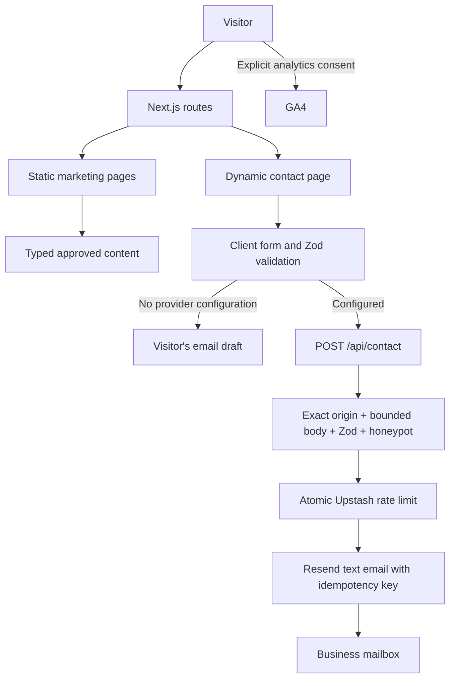

# Zeebaran architecture and design blueprint

## Scope and evidence

The build replaces the missing local source with an original enquiry-led horticulture website. The existing public Zeebaran site and Qul Fruits informed analysis. Public observations cannot establish private database rules, server architecture, operational performance or unpublished catalogue facts.

The prior Zeebaran frontend was a client-rendered React application with React Router, styled-components and Framer Motion. Public assets indicated Firebase integrations, Cloudinary media and a separate contact API. Public catalogue loading states did not expose reliable product records. That is evidence of the observed visitor experience, not proof of the underlying failure cause. Account/admin functionality has not been copied into the replacement: no business requirement or access-control specification was supplied.

Qul's transferable strengths were spacious composition, cohesive typography, clear grouping and prominent orchard photography. Zeebaran has an independent burgundy and warm-white identity, original wordmark treatment, route hierarchy and enquiry journey. No Qul branding, code, photos or product claims are included.

## Information architecture

```text
Home /
├── Our plants /products
│   └── Apple trees /apple-trees
│       ├── Gala /apple-trees/gala
│       └── Red Delicious /apple-trees/red-delicious
├── Orchard installation /orchard-installation
├── Our story /about
├── Contact /contact
└── Privacy /privacy

System: /api/contact, /robots.txt, /sitemap.xml,
        /opengraph-image, /icon.svg, genuine 404/error boundaries
Legacy: /categories → /products (permanent redirect)
```

Unknown old `/category/:id` records cannot be mapped reliably. They return 404 rather than silently misleading visitors. Old auth/admin routes do not exist. Collect Search Console's indexed URLs before authorizing a migration redirect map.

| Route | Visitor purpose | Primary next action |
|---|---|---|
| Home | Understand business, plants and orchard services | Explore apple trees / plan orchard |
| Products | Browse the verified catalogue scope | Read a named selection |
| Apple trees | Understand enquiry details to confirm | Choose Gala or Red Delicious |
| Selection detail | Start a specific planting enquiry | Contact with variety prefilled |
| Installation | Understand stages and scope discussion | Start project conversation |
| About | Understand business location and approach | Contact |
| Contact | Send a clear enquiry through available channel | Email draft or server delivery |
| Privacy | Understand actual processing and preferences | Manage analytics preference |

## Runtime architecture



Server Components render content by default. Pages and catalogue records generate at build time; contact renders on demand to reflect server delivery readiness. Small client islands provide navigation, restrained motion, form state, optional maps and consent. No unnecessary CMS, database, authentication, payments or global state library is introduced.

## Source structure

```text
src/
  app/
    layout.tsx                  fonts, shared shell, metadata, Organization JSON-LD
    page.tsx                    homepage composition
    globals.css                 tokens and responsive component styling
    products/page.tsx
    apple-trees/page.tsx
    apple-trees/[slug]/page.tsx  static catalogue detail generation
    orchard-installation/page.tsx
    about/page.tsx
    contact/page.tsx            query context and server delivery configuration
    privacy/page.tsx
    api/contact/route.ts        HTTP adapter and deployment origin configuration
    error.tsx, not-found.tsx    meaningful recovery paths
    robots.ts, sitemap.ts, opengraph-image.tsx, icon.svg
  components/
    ui.tsx                      shared semantic composition primitives
    header.tsx, footer.tsx       navigation and contact shell
    plant-grid.tsx              reusable content-driven catalogue
    contact-form.tsx            validation, state, retry identity, email draft
    analytics.tsx               consent and event boundaries
    map.tsx                     click-to-load verified embed
    reveal.tsx                  reduced-motion-aware enhancement
  content/plants.ts             typed selection records and service steps
  lib/
    site.ts                     public business configuration and metadata helper
    contact-schema.ts           shared validation + text serialization
    contact-handler.ts          testable transport-independent request policy
    contact-delivery.ts         server-only Redis and email HTTP adapters
public/images/                  original-site images served locally
scripts/check-production.ts     explicit configuration readiness gate
 tests/                         server contracts and failure behavior
.github/workflows/ci.yml         checks and build, no automatic deployment
```

Client modules import only the public site data and shared validation contract. Secret-backed provider functions are used by server routes/pages, never client modules. API logic is injectable, so tests cover failure paths without sending real messages.

## Visual system

| Element | Specification |
|---|---|
| Primary | Burgundy `#A51D2D`; hover `#861724` |
| Ink / muted | `#292524` / `#68615D` |
| Background / alternate | Warm white `#FAF8F5` / stone `#EEE9E2` |
| Secondary accent | Olive `#53634B`, small supporting accents |
| CTA band | Deep burgundy with warm light text |
| Headings | Manrope, moderate weight, tight tracking |
| Body | Source Sans 3, generous line height |
| Editorial emphasis | Georgia italic for selected headline phrases |
| Container | Maximum 1280px; responsive side gutters |
| Section spacing | 112px desktop, 80px tablet, 64px mobile |
| Buttons | Solid or outlined, restrained 3px radius, clear focus |
| Imagery | Crop-aware Next Image, explicit dimensions, responsive sizes |
| Layout | Split hero, typographic catalogue, editorial service/story layouts |
| Motion | Small transform reveals and hover cues; respects reduced motion |

Tailwind v4 is available through the stylesheet. Semantic component classes hold the bespoke visual system; utility sprawl and duplicate styling abstractions are avoided. Fonts self-host through Next's font pipeline. Hero resources have explicit priority, and nonessential imagery loads lazily.

Responsive rules at 1100/1024/767/480 adapt navigation, grids, type and gutters. Mobile uses a disclosure menu, stacked content and large inputs. Status messages are announced politely, form errors are associated with fields, and first invalid fields receive focus. Native details provide keyboard-accessible FAQs. No autoplay, scroll hijacking or decorative loading screen.

## SEO and performance

Each route has its own title, description and canonical. Shared Open Graph artwork, Twitter metadata, XML sitemap, robots, semantic headings and image alternatives are implemented. Organization JSON-LD includes only business name, public contact and locality; no invented ratings, price, coordinates or opening hours. Catalogue pages omit Product offer schema because price/stock are unverified.

Static rendering reduces origin work. Images use AVIF/WebP and responsive variants. Layout reserves image space. Marketing content remains visible without JavaScript; motion is progressive enhancement. Optional third-party scripts stay off until configured and accepted. Lighthouse is lab evidence; INP and real-user Core Web Vitals need traffic and field monitoring after launch.

## Security and operational limits

Contact protection layers are origin checks, JSON-only input, strict Zod validation, bounded body reading, honeypot, Redis rate limiting, provider timeout and idempotency. The application sends plain-text email, preventing user-supplied HTML injection. No secrets or message text are logged. HTTP headers set frame denial, content-type protection, referrer/permissions policies and a content security policy. Inline Next framework scripts require `unsafe-inline`; a stricter nonce policy would require dynamic rendering and should be evaluated against the actual threat model. These controls are not a substitute for provider monitoring or a penetration test.

No service credentials were supplied, so live delivery, GA4 collection, Search Console verification and a business map are pending owner configuration and end-to-end verification. The fallback email-draft flow is intentional and accurately labelled. GitHub CI is prepared; no remote repository or hosting account has been connected.

## Image provenance

Images were retrieved from the existing Zeebaran site for this redesign:

- `orchard.jpg`: `https://zeebaran.com/images/orchardinstallation/appleorch.jpg`
- `planting.jpg`: `https://zeebaran.com/images/orchardinstallation/installation.jpg`
- `orchard-rows.jpg`: `https://zeebaran.com/images/orchardinstallation/appleorch1.jpg`

Use does not establish ownership. Confirm publication rights before release. Images illustrate orchard context, not exact current stock or a verified location. Unused legacy assets are not necessary for the app.

## Provider references

- [Next.js App Router](https://nextjs.org/docs/app)
- [Resend send API](https://resend.com/docs/api-reference/emails/send-email)
- [Upstash Redis REST API](https://upstash.com/docs/redis/features/restapi)
- [Vercel request headers](https://vercel.com/docs/headers/request-headers)
